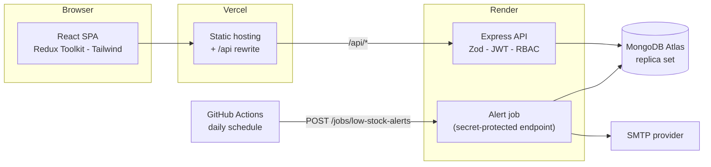
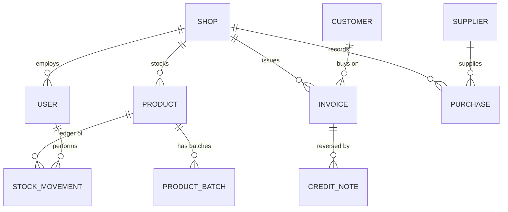
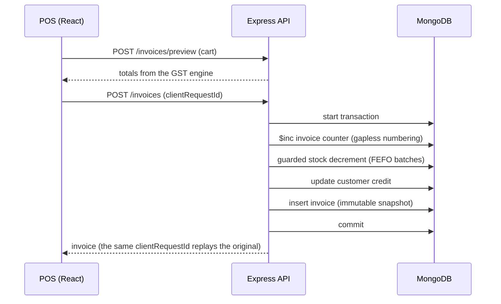

# Inventory & Billing System for Shops

[](https://github.com/utkarsha2006/inventory-billing-system/actions/workflows/ci.yml)

A full-stack point-of-sale, inventory and **GST-compliant billing** system for small Indian retailers, built with the MERN stack. It covers barcode scanning, CGST / SGST / IGST invoicing, batch and expiry tracking, purchases with input tax credit, credit notes, and GSTR-1 / GSTR-3B style reports.

## Features

- **Billing / POS:** fast cart, USB and camera barcode scanning, per-item and per-bill discounts, split payments (cash / UPI / card / credit), change calculator, A4 and 80 mm thermal PDFs.
- **GST done properly:** CGST + SGST vs IGST by place of supply, inclusive and exclusive pricing, exact paise rounding, HSN-wise tax breakup, Bill of Supply for composition and unregistered shops, current slabs (0 / 3 / 5 / 18 / 40 %).
- **Inventory:** products with HSN, SKU, barcode, batch and expiry (FEFO picking), weighted-average costing, an append-only stock ledger (who changed what, and why), low-stock and expiry alerts, and a daily email digest.
- **Purchases:** supplier management, input tax credit (ITC) eligibility, supplier dues and payments.
- **Returns:** credit notes with exact tax reversal, restock rules, store credit, and the Section 34 time limit handled.
- **Reports:** daily and monthly sales, top products, profit and margin, stock valuation, GSTR-1, GSTR-3B and HSN summaries, exportable to CSV and Excel.
- **Security:** JWT access tokens with rotating refresh tokens and reuse detection, role-based access (Owner / Manager / Cashier), rate limiting, helmet, validated input, and formula-injection-safe exports.

## Tech stack

| Layer | Technology |
|---|---|
| Frontend | React (Vite), React Router, Redux Toolkit, Tailwind CSS, React Hook Form + Zod, Recharts, html5-qrcode |
| Backend | Node.js, Express, Mongoose, Zod, PDFKit, ExcelJS, node-cron, Nodemailer |
| Database | MongoDB (Atlas in production), multi-document transactions |
| Testing | Jest + Supertest + mongodb-memory-server (API), Vitest (client) |
| Delivery | GitHub Actions, Vercel, Render, MongoDB Atlas |

## Architecture



The backend is layered: **routes → validators (Zod) → thin controllers → services (business rules) → models**. GST maths, rounding, return apportionment and tax set-off are *pure functions* in `utils/`, so they are unit-tested without a database.

### Data model



Every business document carries a `shopId` and every index starts with it, so adding multi-shop support later is an additive change.

### Checkout flow



## Key engineering decisions

| Problem | Decision |
|---|---|
| Floating-point money | Integer **paise** everywhere, quantities as integer **thousandths**, BigInt for intermediate products |
| Overselling under concurrency | The stock check is part of the update filter (`stockMilli: { $gte: qty }`), inside a transaction |
| Gapless invoice numbers | The per-financial-year counter is incremented inside the billing transaction, so an abort rolls it back |
| Double-submitted bills | `clientRequestId` plus a unique index returns the original invoice on replay |
| Tax rounding | Tax per line, CGST/SGST split with the odd paisa to SGST, one round-off per invoice |
| Old invoices changing | Items, customer and shop details are snapshotted. Invoices are never edited, only reversed by credit notes |
| Partial returns | Credit amounts are differences of cumulative proportional shares, so any sequence of returns sums exactly to the original line |
| Stolen refresh token | Single-use rotation with reuse detection revokes the whole session family |
| Spreadsheet formula injection | Text cells starting with `= + - @` are neutralised in CSV and Excel exports |
| Free-tier cold starts | Scheduled jobs run through a secret-protected endpoint, with an atomic "sent today" claim so retries never double-send |

## GST notes

- **Rate slabs:** 0, 3, 5, 18 and 40 %, in one constant (`GST_RATES`) so a future change is a one-line edit.
- **Intra-state vs inter-state:** decided by place of supply against the shop's state. Intra-state sales split into CGST + SGST, inter-state sales use IGST.
- **Bill of Supply:** composition and unregistered shops issue a tax-free Bill of Supply instead of a Tax Invoice.
- **GSTR-1 style summary:** B2B, B2C large (inter-state above ₹1 lakh), B2C small, nil-rated, credit notes, and the HSN summary split into B2B and B2C.
- **Credit notes and Section 34:** a credit note issued after 30 November following the financial year of the original invoice is excluded from the tax figures and listed separately.
- **GSTR-3B style summary:** output tax vs input tax with the GST utilisation order. The numbers are working summaries to prepare a return, **not tax advice** and **not portal-upload files**. Check them against the GST portal or with your accountant.

## Getting started

**Prerequisites:** Node.js 20+, Docker (for a local MongoDB replica set; transactions need a replica set).

```bash
git clone https://github.com/utkarsha2006/inventory-billing-system.git
cd inventory-billing-system

# 1. MongoDB as a single-node replica set
docker compose up -d

# 2. API
cd server
cp .env.example .env          # PowerShell: Copy-Item .env.example .env
```

Open `server/.env` and fill in the two JWT secrets. Generate each one with:

```bash
node -e "console.log(require('crypto').randomBytes(48).toString('hex'))"
```

```bash
npm install
npm run seed                  # optional: a realistic demo shop
npm run dev                   # API on http://localhost:5000/api/v1

# 3. Frontend (new terminal)
cd client
npm install
npm run dev                   # app on http://localhost:5173 (Vite proxies /api to the API)
```

**Demo logins** (after `npm run seed`): `owner@demo.shop`, `manager@demo.shop`, `cashier@demo.shop`, password `Demo@12345`.

**Rupee sign in PDFs:** put `NotoSans-Regular.ttf` and `NotoSans-Bold.ttf` (free, OFL licence, from Google Fonts) in `server/src/pdf/fonts/`. Without them, PDFs fall back to Helvetica and print `Rs.` instead of `₹`.

### Environment variables (`server/.env`)

| Variable | Required | Purpose |
|---|---|---|
| `MONGODB_URI` | yes | Connection string. Locally: `mongodb://localhost:27017/inventory_billing?replicaSet=rs0&directConnection=true` |
| `JWT_ACCESS_SECRET`, `JWT_REFRESH_SECRET` | yes | 16+ characters each, different from each other |
| `PORT`, `NODE_ENV` | no | Default `5000` / `development` |
| `ACCESS_TOKEN_TTL`, `REFRESH_TOKEN_TTL_DAYS`, `BCRYPT_ROUNDS` | no | Defaults `15m`, `7`, `12` |
| `CLIENT_ORIGIN` | no | Only for direct cross-origin calls (not needed with the Vercel rewrite) |
| `TRUST_PROXY` | no | Proxy hops in front of the API: `1` on Render alone, `2` behind a Vercel rewrite |
| `SMTP_HOST`, `SMTP_PORT`, `SMTP_USER`, `SMTP_PASS`, `ALERT_FROM_EMAIL` | no | Alert emails. Leave `SMTP_HOST` empty to log instead of sending |
| `ENABLE_CRON` | no | `true` only on an always-on server, otherwise use the jobs endpoint |
| `CRON_SECRET` | no | Enables `POST /api/v1/jobs/low-stock-alerts` for an external scheduler |

## Tests

```bash
cd server && npm test      # unit + API tests against an in-memory MongoDB replica set
cd client && npm test      # cart maths
```

The suite covers the GST engine (including randomized invariants), concurrent stock deductions, idempotent checkout, FEFO batches, return arithmetic, tax set-off, role permissions, tenant isolation, PDF rendering and exports. The API tests start their own in-memory database, so they never touch your development data.

## Project structure

```
inventory-billing-system/
├── server/
│   ├── src/{config,models,routes,controllers,services,validators,middleware,jobs,pdf,utils}
│   ├── scripts/seed.js
│   └── tests/{unit,api,helpers}
├── client/src/{app,api,features,components,hooks,utils}
├── .github/workflows/        # CI and the daily alert trigger
├── render.yaml               # backend infrastructure
└── docker-compose.yml        # local MongoDB replica set
```

## API overview

All routes are under `/api/v1`. JSON responses look like `{ success, data, meta? }`.

| Area | Endpoints |
|---|---|
| Auth | `POST /auth/register-shop`, `/login`, `/refresh`, `/logout`; `GET /auth/me`; `PATCH /auth/change-password` |
| Shop and users | `GET/PATCH /shop`; `GET/POST /users`; `PATCH /users/:id`; `POST /users/:id/reset-password` |
| Products | `GET/POST /products`; `GET /products/barcode/:code`; `GET/PATCH/DELETE /products/:id`; `POST /products/:id/stock-adjustments`; `GET /products/:id/stock-movements`; `GET/POST /products/:id/batches` |
| Billing | `POST /invoices/preview`, `POST /invoices`; `GET /invoices`, `/invoices/:id`, `/invoices/:id/pdf`; `POST /invoices/:id/payments`, `/invoices/:id/returns` |
| Credit notes | `GET /credit-notes`, `/credit-notes/:id`, `/credit-notes/:id/pdf` |
| Customers, suppliers, purchases | CRUD, plus `POST /purchases/:id/payments` |
| Reports | `GET /dashboard/summary`; `/reports/sales/daily`, `/sales/monthly`, `/top-products`, `/profit`, `/stock-valuation`, `/gst/gstr1`, `/gst/gstr3b`, `/gst/hsn-summary` (add `?format=json\|csv\|xlsx`) |
| Alerts and jobs | `GET /alerts`; `POST /jobs/low-stock-alerts` (secret header) |

### Roles

| Capability | Owner | Manager | Cashier |
|---|---|---|---|
| Shop settings, user management | ✅ | ❌ | ❌ |
| Products, suppliers, purchases, stock adjustments | ✅ | ✅ | ❌ |
| Create invoices, look up products | ✅ | ✅ | ✅ |
| Returns and credit notes | ✅ | ✅ | ❌ |
| Reports, GST exports, cost and profit data | ✅ | ✅ | ❌ |

## Deployment

Frontend on **Vercel**, API on **Render**, database on **MongoDB Atlas**. Vercel rewrites `/api/*` to Render, so the browser only ever talks to one origin and the refresh cookie stays first-party. In short:

1. Create an Atlas M0 cluster and a `readWrite` user for one database.
2. Create the Render service from `render.yaml` and set `MONGODB_URI`.
3. Put your Render URL in `client/vercel.json`, then import `client/` into Vercel.
4. Add `API_URL` and `CRON_SECRET` as GitHub secrets for the daily alert workflow.
5. Check that the Render logs show real client IPs (`TRUST_PROXY=2` behind the Vercel rewrite).

Free tiers are fine for a demo: the API sleeps when idle (the first request can take 30 to 50 seconds), and free Atlas clusters have no automated backups.

## Limitations and roadmap

- GST reports are **working summaries for review**. Not covered: amendments, e-commerce supplies, exports and SEZ, reverse charge, ITC reversals, composition returns.
- The API exists but the UI does not yet have screens for returns, purchases, suppliers, the customer ledger, user management and shop settings.
- No offline mode, e-invoicing (IRN) or multi-shop UI. The schema is ready for multi-shop.
- Reports load a period's documents into memory, which suits one shop's month or quarter but not very high volumes.

## License

MIT. See [LICENSE](LICENSE).

Built by [@utkarsha2006](https://github.com/utkarsha2006).
